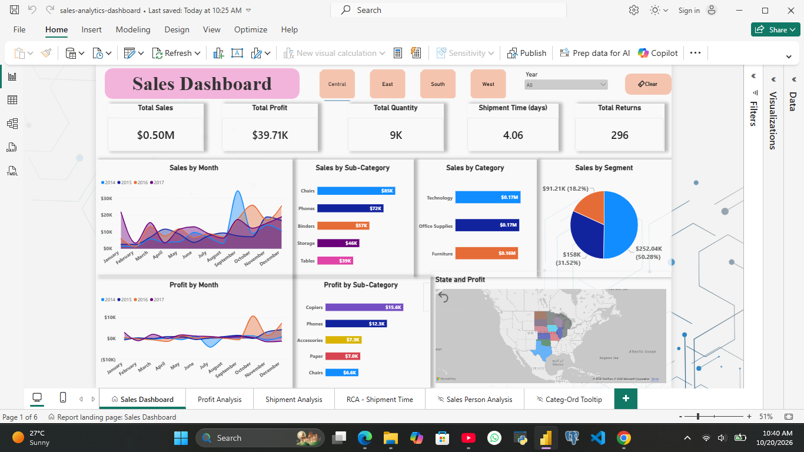
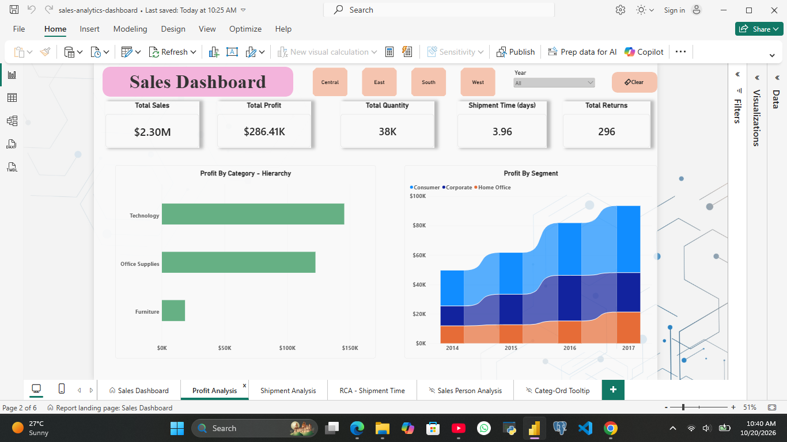
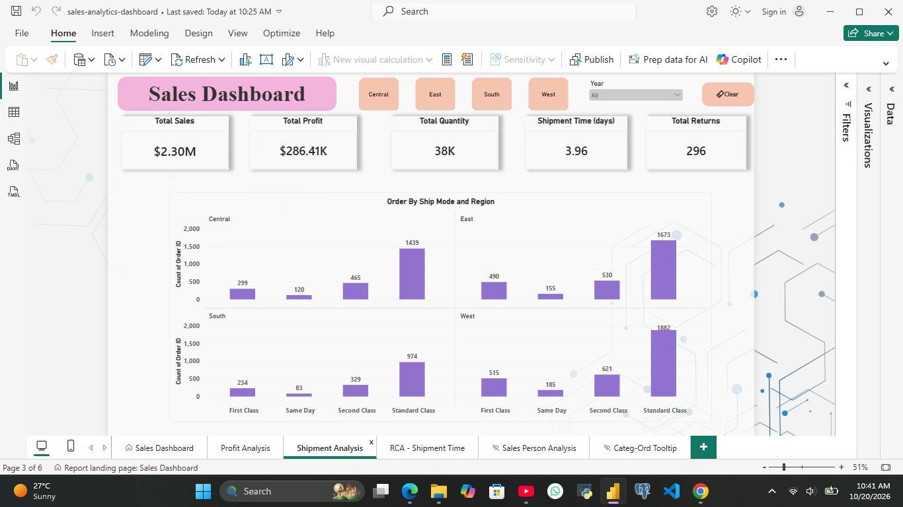
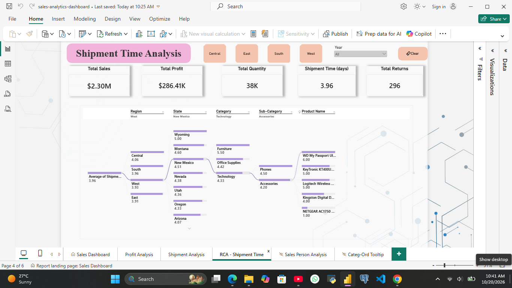

# Sales Analytics Dashboard | Power BI

An interactive Power BI dashboard designed to explore sales performance, profitability, customer segments, shipping operations, and shipment-time drivers through visual analytics.

## Project Overview

This project presents a multi-page sales analytics report built in Microsoft Power BI. It brings together key performance indicators, comparative charts, geographical analysis, and interactive report navigation to support exploration of sales and operational performance.

The dashboard includes dedicated pages for overall sales performance, profit analysis, shipment analysis, and shipment-time root-cause exploration.

## Dashboard Preview



## Dashboard Pages

### 1. Sales Dashboard

Provides an overview of sales performance through KPI cards and visualizations, including:

- Total Sales, Total Profit, Total Quantity, Total Returns, and Shipment Time.
- Sales by category and sub-category.
- Sales distribution by customer segment.
- Monthly sales and profit trends.
- Profit by sub-category.
- Geographical analysis using a filled map.
- Year-based filtering and interactive report controls.

### 2. Profit Analysis

Focuses on profitability through:

- Profit by category hierarchy.
- Profit by customer segment.
- KPI cards for sales, profit, quantity, returns, and shipment time.
- Geographical exploration of performance.



### 3. Shipment Analysis

Explores shipping and order patterns through:

- Order analysis by shipping mode and region.
- Shipment-related KPI cards.
- Interactive filters for exploring report data.



### 4. Shipment-Time Root Cause Analysis

Uses a decomposition tree to investigate shipment-time drivers and explore contributing dimensions, helping users examine operational patterns at different levels of detail.



### 5. Drill-Through Analysis and Tooltips

The report also includes a dedicated drill-through page for sales-person analysis and a hidden tooltip page for additional contextual analysis.

## Interactive Features

- KPI cards for monitoring key performance indicators.
- Category, sub-category, segment, and regional analysis.
- Year-based filtering.
- Drill-through navigation for more detailed analysis.
- Decomposition-tree exploration for shipment-time investigation.
- Report navigation and reset/clear-filter controls.
- Custom tooltip functionality.

## Tools and Technologies

- **Microsoft Power BI Desktop** — report development and visualization.
- **Interactive data visualization** — KPI cards, charts, maps, and decomposition trees.
- **Power BI report features** — slicers, drill-through, tooltips, and bookmarks.

## Repository Structure

```text
power-bi-sales-analytics-dashboard/
├── README.md
├── dashboard/
│   └── sales-analytics-dashboard.pbix
└── screenshots/
    ├── overview.png
    ├── profit-analysis.png
    ├── shipment-analysis.png
    └── shipment-time-rca.png
```

## How to View the Dashboard

1. Clone or download this repository.
2. Download the Power BI report from the `dashboard/` folder.
3. Open `sales-analytics-dashboard.pbix` in Microsoft Power BI Desktop.
4. Navigate between report pages and interact with the available slicers, drill-through functionality, and visualizations.

**Note:** Data refresh may require access to the original data source and any necessary connection settings.

## Dataset

The dataset source, attribution, and redistribution permissions should be documented here before publication. Any dataset included with this project must be shared in accordance with its applicable license and usage terms.

## Author

**Pulkit Narang**

- GitHub: [pulkitn-analytics](https://github.com/pulkitn-analytics)

